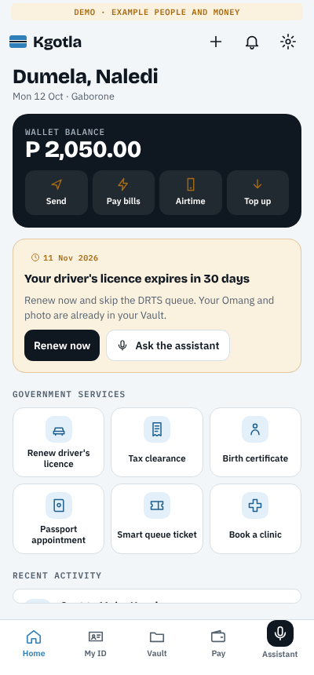
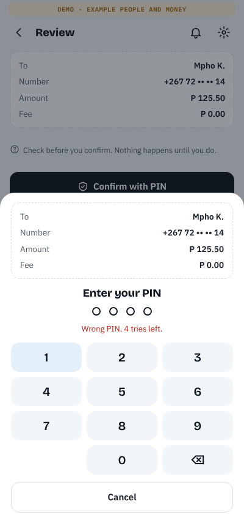
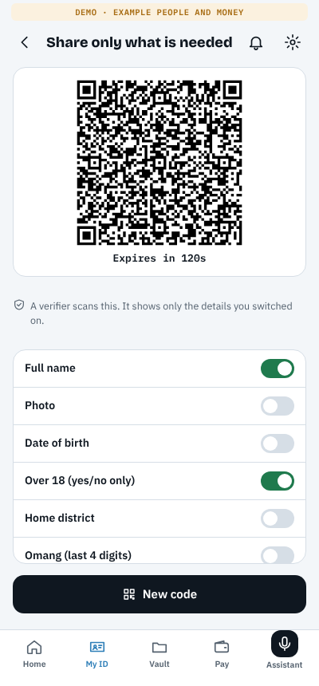

# Kgotla

**One account for every public service.** Kgotla is a citizen platform for Southern Africa, starting with Botswana: a person proves who they are once, then renews a driver's licence, pays bills, gets a tax clearance, books a clinic or takes a queue ticket from one phone, by app, by USSD on any phone, or by asking an AI assistant.

Phase 2 runs the same build as separate **country cells** for Botswana, South Africa, Namibia, Zambia and Zimbabwe. Each cell has its own database, national ID rules, phone numbers, currency, agencies, billers and mobile-money networks, and deploys to Azure with one workflow.

The *kgotla* is the Tswana public meeting place where any citizen can bring a matter and be heard. The product takes its name and its promise from it.

<p>



</p>

## What works today

| Area | What a citizen or officer can do |
|---|---|
| **Digital identity** | Enrol with Omang number → SMS code → selfie liveness and face match → PIN, reaching assurance level 3. Sign in with Omang + PIN (lockout after 5 wrong tries). |
| **Selective disclosure** | Show a one-time, signed QR that reveals only chosen claims (e.g. *over 18: yes* without the birth date). Verifiers check it at `/verify.html`; tampering and expiry are detected. |
| **Vault** | Documents issued straight in by institutions (Omang, licence, tax clearance, BGCSE…) via an issuer API. Share any document by a 24-hour link and withdraw it at any time. |
| **Wallet** | Double-entry ledger in thebe. Send to any Kgotla number, BPC prepaid electricity (returns a 20-digit token), Water Utilities, Mascom/Orange/BTC airtime, top-up from Orange Money or MyZaka. |
| **Government services** | Driver's licence renewal (fee, eye-test booking, 4-step workflow, new licence issued to the Vault), instant BURS tax clearance, birth certificate copy. Services are data, so ministries add new ones without a release. |
| **Bookings & smart queue** | Clinic and passport appointments with real capacity. Take a queue ticket from home; counters call the next person, who gets an SMS, and whoever is 3 places away is warned. |
| **USSD `*321#`** | ID, balance, send money, BPC, licence status, tax clearance and queue tickets on a feature phone with no data. Unregistered phones can still take a queue ticket. |
| **AI assistant** | Claude, server-side, reads the citizen's own records and *prepares* actions. It has no tool that can execute; the citizen confirms every payment with their PIN. Falls back to a basic mode without an API key. |
| **Partner hub** | Clinics, doctors, pharmacies, banks, mobile-money operators, insurers, utilities, networks, schools and employers apply at `/partners.html`; their licence is checked with the regulator and a Kgotla admin approves them. They get OAuth API keys and signed webhooks, ask citizens for consent (approved in the app with a PIN, withdrawable any time), then verify identity (eKYC), issue sick notes or statements to the Vault, send bills citizens pay with their PIN, and publish bookable clinic slots. See [docs/PARTNERS.md](docs/PARTNERS.md). |
| **Officer console** | Case workers advance or reject applications for their agency (rejections refund fees automatically). Counter staff run the queue. Admins see ledger and audit-chain integrity. |
| **Works on African realities** | Installable PWA, offline shell with the last account summary, 2G-friendly payloads, data-saver, Setswana, USSD, SMS for every important event. |

## Countries

| Cell | ID | Currency | Licence / civil / tax agencies | Bills and airtime | Top up from |
|---|---|---|---|---|---|
| **BW** Botswana | Omang, 9 digits | Pula (P) | DRTS · CNR · BURS | BPC, WUC, Mascom, Orange, BTC | Orange Money, MyZaka |
| **ZA** South Africa | 13-digit ID, checksum checked | Rand (R) | DLTC · DHA · SARS | Eskom, Johannesburg Water, Vodacom, MTN, Cell C, Telkom | PayShap, Instant EFT |
| **NA** Namibia | 11-digit ID | Namibia dollar (N$) | NaTIS · MHAISS · NamRA | City of Windhoek electricity and water, MTC, TN Mobile, Paratus | MTC Maris, bank transfer |
| **ZM** Zambia | NRC `123456/78/1` | Kwacha (K) | RTSA · DNRPC · ZRA | ZESCO, LWSC, MTN, Airtel, Zamtel | MTN MoMo, Airtel Money |
| **ZW** Zimbabwe | `63-245718K42` | US dollar (US$) | VID · Registrar General · ZIMRA | ZESA, Harare water, Econet, NetOne, Telecel | EcoCash, OneMoney |

Pick a cell with `KGOTLA_COUNTRY`. Botswana also has Setswana; the other cells start in English. [docs/COUNTRIES.md](docs/COUNTRIES.md) explains how a country pack works and lists the facts each country's team must confirm before a pilot.

## The one rule that keeps citizens safe

Every operation that moves money, submits an application or books a slot on a citizen's behalf is a **confirmable action**:

1. It is *prepared* with a plain-language read-back ("Send P 200.00 to Mpho K., fee P 0.00").
2. Nothing happens until the citizen *confirms*, with their PIN for anything that costs money.
3. It executes *at most once*, under a row lock, with an idempotent ledger entry and an audit record.

The app, USSD and the AI assistant all go through this one path. See [docs/ARCHITECTURE.md](docs/ARCHITECTURE.md).

## Quick start

**Docker (easiest):**

```bash
docker compose up --build
# open http://localhost:8080
```

**Local (Node 20+ and PostgreSQL 14+):**

```bash
npm install
createdb kgotla
DATABASE_URL=postgres://localhost/kgotla npm run dev     # migrates, seeds demo data, serves on :8080

# another country (each country needs its own database)
createdb kgotla_za
KGOTLA_COUNTRY=ZA DATABASE_URL=postgres://localhost/kgotla_za npm run dev
```

With Docker: `KGOTLA_COUNTRY=ZA docker compose up --build` (run `docker compose down -v` first when switching country).

Add `ANTHROPIC_API_KEY=…` to turn on the Claude assistant.

| Page | URL |
|---|---|
| Citizen app (PWA) | `/` |
| Officer console | `/officer.html` |
| ID verifier | `/verify.html` |
| USSD simulator | `/ussd.html` |
| Partner portal | `/partners.html` |

### Demo accounts (demo mode only)

Botswana is below. Every cell's sign-in screen and officer console list its own demo people; for example South Africa's Thandiwe Nkosi `910623 0120 087`, Namibia's Ndapewa Shikongo `890314 00123`, Zambia's Mutale Banda `234561/11/1` and Zimbabwe's Rudo Chikore `63-245718K42`, all with PIN `2580`. Officers follow the same pattern (`dltc.case`, `natis.case`, `rtsa.case`, `vid.case`, …).


| Who | Sign in | |
|---|---|---|
| Naledi Mothibi | Omang `435721904`, PIN `2580` | licence expiring in 30 days |
| Mpho Kgosi | Omang `512810117`, PIN `1357` | |
| Kabelo Seretse | Omang `287410556`, PIN `2468` | |
| New sign-up | Omang `341926728` or `778215043` | in the mock registry, not yet enrolled |
| DRTS case worker | `drts.case` / `kgotla-demo` | also `cnr.case`, `burs.case` |
| DRTS counter | `drts.counter` / `kgotla-demo` | |
| Partner portal | `clinic@demo.kgotla`, `bank@demo.kgotla`, `doctor@demo.kgotla` / `kgotla-demo` | clinic and bank approved, doctor waiting for review; API keys `demo-clinic` / `demo-clinic-secret`, `demo-bank` / `demo-bank-secret` |
| Admin | `admin` / `kgotla-demo` | |

Demo mode shows SMS codes on screen and gives every wallet example money (P 2,500.00 in Botswana, scaled to each country). It refuses to start with `NODE_ENV=production`.

## Tests

```bash
npm test     # 85 integration tests against a real PostgreSQL (set TEST_DATABASE_URL)
```

They cover, among other things: overdraw protection under racing confirmations, append-only and balanced ledger enforced by the database, PIN lockout, end-to-end licence renewal with officer approval and agency isolation, fee refunds, tamper detection on ID codes, share-link revocation, queue notifications, the USSD menu, and the assistant being unable to execute anything it prepares. Each Phase 2 country is tested end to end: its ID and phone formats, a local bill payment, a licence renewal approved by its own officer, and a cell refusing another country's database. The partner hub is tested from application to approval, consent with PIN, eKYC, document issuing, bills paid once, clinic bookings, signed webhooks with retries, withdrawal and suspension.

## Deploying to Azure

`infra/` holds Bicep for a shared platform plus one isolated cell per country (Container Apps, PostgreSQL with managed-identity sign-in and no passwords, Key Vault). `.github/workflows/deploy.yml` deploys on every push to `main` once three secrets exist. [docs/DEPLOY.md](docs/DEPLOY.md) walks through the one-time setup, starting from no Azure subscription.

## Project layout

```
apps/api           Fastify + TypeScript API, PostgreSQL
  migrations/      SQL schema (ledger triggers, audit chain)
  src/countries/   country packs: BW, ZA, NA, ZM, ZW
  src/modules/     identity, ledger, actions, gov, vault, places, ussd, assistant
  src/cli.ts       operator commands: create-officer, rotate-issuer-key, verify-integrity
  test/            integration tests
apps/web           citizen PWA, officer console, verifier, USSD simulator (no build step)
infra/             Azure Bicep, bootstrap script
docs/              architecture, deployment, countries, security, pilot readiness
```

## Before a real pilot

The national registry, liveness vendor, SMS gateway, mobile-money collection and BPC vending are **adapters with mock implementations**. [docs/PILOT.md](docs/PILOT.md) lists each integration, the regulatory steps (Bank of Botswana, Information and Data Protection Commission) and the security work required before real citizens use it.

## Docs

- [Architecture](docs/ARCHITECTURE.md): modules, data model, flows
- [Security](docs/SECURITY.md): controls and known gaps
- [API](docs/API.md): endpoints
- [Pilot readiness](docs/PILOT.md): what to replace and approve before going live
- [Deploying to Azure](docs/DEPLOY.md): one-time setup and the deploy workflow
- [Countries](docs/COUNTRIES.md): country packs and what to confirm per country
- [Partners](docs/PARTNERS.md): onboarding clinics, doctors, banks and others, business and technical
