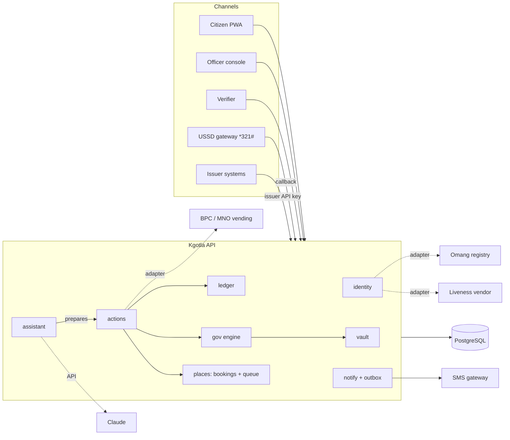

# Architecture

Phase 1 runs as a **modular monolith**: one Node.js (Fastify, TypeScript) service and one PostgreSQL database per country cell. Phase 2 runs five cells (Botswana, South Africa, Namibia, Zambia, Zimbabwe) from the same build. Module boundaries match the blueprint's future microservices (identity, consent, vault, payments, gov engine, places, notifications, AI), so each can be split out when scale demands it, without changing the API.



## Country cells

`KGOTLA_COUNTRY` selects a country pack (`src/countries/`) at start-up: national ID rules, phone numbering, currency, agencies, services and fees, billers, mobile-money sources, offices, limits, languages and demo data. Everything that differs between countries is data in the pack; the modules, the assistant's tool schema, USSD menus and web clients read it. `GET /v1/config` publishes the non-secret part of the pack to the web apps.

Each cell has its own database, bound to its country on first start (`cell_meta`); a cell refuses to start against another country's database. Identifier hashes use a per-country prefix, so the same number in two countries never collides. Cells do not share data: a citizen who moves country enrols in the new cell. Cross-border features (remittances, mutual ID recognition) are a later phase and would go through explicit, consented APIs between cells.

On Azure each cell is a Container App with its own managed identity, Key Vault and PostgreSQL server, behind a shared registry and Container Apps environment (`infra/`, [DEPLOY.md](DEPLOY.md)). The app signs in to PostgreSQL with a Microsoft Entra token from its managed identity, so no database password exists.

## Confirmable actions

The single path for anything that spends money or acts for a citizen.

```mermaid
sequenceDiagram
  participant C as Citizen (app / USSD)
  participant A as Assistant (Claude)
  participant API as actions module
  participant DB as PostgreSQL
  A->>API: propose_send_money(to, amount)
  API->>DB: validate, check funds, INSERT pending_actions (readback, expires 10 min)
  API-->>A: "waiting for citizen confirmation"
  A-->>C: "Tap the button to send P 200.00 to Mpho K."
  C->>API: POST /v1/actions/:id/confirm {pin}
  API->>DB: verify PIN in its own transaction (failures always counted)
  API->>DB: BEGIN; lock action row; post ledger entry (idempotency key = action id); audit; mark done; COMMIT
  API-->>C: result (message, token, reference)
```

Properties:

- **Read-back first.** The citizen always sees amount, recipient or service before anything happens.
- **PIN for money.** Payments, fees and transfers need the PIN; free bookings and tickets need an explicit tap.
- **Exactly once.** The action row is locked; a double tap or retried request returns the existing result. Ledger entries carry the action id as idempotency key.
- **Expires.** Unconfirmed actions expire after 10 minutes.
- **Same path for every channel.** `source` records `app`, `ussd` or `assistant`; the audit actor for assistant-prepared actions is `assistant:<citizen>`.

## Ledger

- Amounts are integer **thebe**. No floating point anywhere in money paths.
- Strict double entry: debit positive, credit negative. A deferred constraint trigger rejects any entry that does not sum to zero at commit.
- `postings` and `audit_log` are append-only (triggers reject UPDATE and DELETE).
- Citizen wallets are liability accounts; their balance is `-sum(postings)`. Posting locks all involved accounts in id order (no deadlocks), then rejects the entry if any wallet would go negative.
- Government fees credit `payable:agency:<AGENCY>`; bills credit `payable:biller:<id>`; top-ups debit `settlement:<source>`. These are the accounts that reconcile against partner bank and operator statements.

## Government service engine

Services are rows in `service_templates`: agency, fee, ordered steps and the document issued at the end. An application opens with the fee charged; officers of the owning agency move it forward one step at a time; the final step issues the output document into the Vault and supersedes any older document of the same type. Rejection refunds the fee through the ledger with its own idempotency key.

## Identity

- The national ID number (Omang in Botswana) is stored only as an HMAC (keyed with `KGOTLA_SECRET`, prefixed per country) plus its last 4 characters. The raw number lives only for the 20-minute life of an enrolment and is then erased.
- Enrolment: registry lookup → SMS OTP (5 attempts) → liveness + 1:1 face match (selfie never stored) → PIN (scrypt) → assurance level 3.
- Selective disclosure tokens are signed (HMAC-SHA256 in Phase 1; Ed25519 in an HSM for production so verifiers can check offline), contain only chosen claims, and expire after 2 minutes. `disclosures` stores which claim *names* were shared, never values.

## Assistant

Claude runs server-side with a fixed system prompt and twelve tools: two that read the signed-in citizen's data, nine `propose_*` tools that create pending actions, and `request_human_agent`. There is no tool that confirms or executes. Tool errors return to the model as `is_error` results so it can explain them. Tool output is marked as data, not instructions. Without `ANTHROPIC_API_KEY` a small keyword mode answers instead.

## Channels

- **PWA** (`apps/web`): no build step, about 40 KB to download on first visit (Brotli/gzip; 90 KB uncompressed), then cached; service worker for the offline shell, last account summary cached on the device, background refresh off in data-saver mode.
- **USSD**: Africa's Talking callback format (`sessionId`, `phoneNumber`, cumulative `text`); `CON`/`END` responses; pending action ids are kept per USSD session so a confirmation never creates a duplicate.
- **SMS**: written to a transactional outbox inside the same database transaction as the event, then delivered by a worker (`FOR UPDATE SKIP LOCKED`, retries).

## Data model (main tables)

`citizens`, `enrolments`, `sessions`, `officers`, `disclosures` · `documents`, `share_links`, `issuers` · `ledger_accounts`, `journal_entries`, `postings`, `billers` · `pending_actions` · `service_templates`, `applications`, `application_events` · `locations`, `appointments`, `queue_tickets` · `notifications`, `outbox`, `ussd_sessions` · `audit_log`.

See `apps/api/migrations/001_init.sql`.
